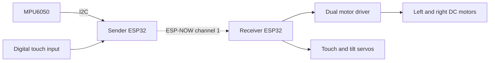

# Hand-Controlled Car

ESP32 firmware for a gesture-controlled robot car. A handheld MPU6050 sensor measures tilt and sends data over ESP-NOW; a second ESP32 controls two DC motors and two servos using FreeRTOS tasks.

> Both boards use the same versioned packet format and encrypted ESP-NOW pairing. Configure your two station MAC addresses before flashing for operation. Unconfigured firmware prints its station MAC and leaves the car stopped.

## System overview



The sender estimates roll and pitch using a complementary filter and attempts transmission every 20 ms. The receiver implements differential drive mixing, a 5-degree dead zone, servo control, and a single actuator task that stops the motors when the newest valid packet reaches 500 ms old. The tilt servo follows pitch from -90 to +90 degrees. Host regression tests cover packet validation and timeout logic; physical hardware validation is still required.

## Hardware

- Two ESP32 development boards compatible with PlatformIO's `esp32dev` target.
- An MPU6050 accelerometer/gyroscope at I2C address `0x68`.
- A digital touch module with a 3.3 V compatible output.
- A dual H-bridge driver with IN1-IN4 and ENA/ENB inputs, two DC motors, and a chassis.
- Two servos and power supplies appropriate for the selected motors and servos.

See the [wiring tables](docs/hardware.md) for the GPIO assignments used by the source code.

## Build

Install [PlatformIO](https://docs.platformio.org/en/latest/core/installation/index.html), or open this folder with the PlatformIO extension in VS Code. The project pins the Espressif32 platform to `6.12.0` and uses ESP-IDF.

```sh
git clone https://github.com/yousef-ashkontna/hand-controlled-car.git
cd hand-controlled-car
pio run
```

Build a single board:

```sh
pio run -e sender
pio run -e receiver
```

`platformio.ini` passes the firmware role to CMake so each environment compiles its own `app_main`. The MPU6050 driver is an ESP-IDF component under `components/`. Generated configuration and build files are ignored; `sdkconfig.defaults` preserves the original 2 MB flash setting.

## Configure and flash

1. Follow the [pairing instructions](docs/hardware.md#pairing) to obtain both station MAC addresses and generate local keys.
2. Run `pio run -t clean`, then rebuild and flash **both** boards using the same generated pairing configuration.
3. Connect one board at a time, or select its serial port explicitly. Replace COM5 and COM6 below with your actual ports.

```sh
pio device list
pio run -e receiver -t upload --upload-port COM5
pio device monitor -e receiver --port COM5
pio run -e sender -t upload --upload-port COM6
pio device monitor -e sender --port COM6
```

Both boards use Wi-Fi channel 1 and a 115200 baud serial monitor. No router or Wi-Fi network credentials are required. Perform initial motor tests with the wheels raised and verify stop behavior before driving.

## Repository layout

```text
hand-controlled-car/
|-- .github/workflows/build.yml   # Build both firmware environments
|-- components/mpu6050/          # Local ESP-IDF sensor component
|-- docs/
|   |-- hardware.md             # Wiring, pairing, and hardware checks
|   `-- architecture.md         # Tasks, control flow, and wire protocol
|-- include/                    # Shared interfaces; ignored local pairing keys
|-- scripts/                    # Pairing setup and host test runner
|-- tests/                      # Protocol, timeout, and sensor regression tests
|-- src/
|   |-- common/                 # Shared packet, control, and radio code
|   |-- sender/main.c           # Sensor sampling and ESP-NOW transmission
|   |-- receiver/main.c         # One actuator task including the failsafe
|   `-- CMakeLists.txt          # Select the firmware entry point
|-- CMakeLists.txt              # ESP-IDF project
|-- platformio.ini             # Shared settings and board environments
|-- sdkconfig.defaults         # Versioned configuration defaults
`-- CONTRIBUTING.md
```

## Development

Read the [architecture](docs/architecture.md) and [contribution guide](CONTRIBUTING.md). Run the host tests with Python and GCC or Clang:

```sh
python scripts/test_host.py
```

GitHub Actions runs these regression tests and builds both firmware environments on pushes and pull requests. A successful build does not verify wiring, radio interoperability, or physical stop behavior.

No software license has been selected for this repository.
